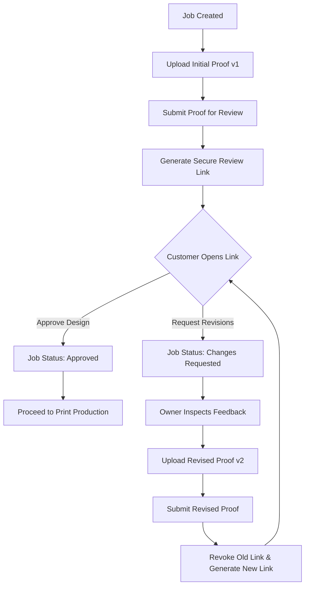

# 🔄 ProofLoop

> **The modern, full-stack client proof approval and revision management platform designed for print shops, design studios, and production teams.**

ProofLoop streamlines the print production lifecycle by connecting print shop owners and clients through secure, tokenized review portals. Clients review high-resolution proofs, request revisions with structured feedback, or approve artwork for production—**with zero account creation or sign-in friction**.

---

## ✨ Key Features

### 📋 Job & Order Management
- **Autogenerated Job Numbers**: Format `JOB-01001` with sequential PostgreSQL sequence generation.
- **Order Tracking**: Customer contact information, print quantities, due dates, artwork specifications, and internal shop-only notes.
- **Production Status Lifecycle**:
  `Awaiting Proof` ➔ `Awaiting Customer Review` ➔ `Changes Requested` ➔ `Approved` ➔ `In Production` ➔ `Quality Check` ➔ `Ready for Delivery` ➔ `Completed`

### 🎨 Design Proof Versioning & Secure Storage
- **Private Supabase Storage**: Dedicated `proof-files` private bucket supporting PDF, PNG, and JPEG formats (up to 20 MB).
- **Automated Version Numbering**: Serialized, concurrency-safe version generation (`v1`, `v2`, `v3`) via database triggers.
- **Signed URL Access**: Short-lived (1-hour) signed URLs prevent unauthorized public access to client artwork.
- **Orphan Cleanup**: Automatic storage file rollback if database record creation fails.

### 🔗 Secure Customer Review Links
- **Passwordless Customer Access**: Tokenized URLs (`/review/:token`) eliminate registration hurdles for customers.
- **Cryptographic Security**: Tokens generated using CSPRNG 32-byte entropy and stored exclusively as SHA-256 hashes.
- **Link Lifecycle Controls**: Configurable validity window (1–30 days, default 7 days) and instant one-click link revocation.
- **Tamper-Proof Validation**: Strict server-side verification checks revocation state, expiration timestamps, and superseded statuses.

### ✍️ Customer Proof Approval & Revision Requests
- **Dedicated Review Portal**: Responsive design with zoomable image preview and in-browser PDF viewing.
- **Approve Design**: Explicit confirmation dialogue that records official client authorization and locks the decision.
- **Request Revisions**: Structured feedback form requiring actionable, trimmed notes (enforced max 2,000 characters).
- **Atomic Decision Recording**: Single-transaction database RPCs eliminate concurrent conflicting decisions and update job statuses immediately.
- **Read-Only Finality**: Returning customers see their recorded decision and submitted feedback, preventing conflicting overwrites.

### 🔁 Revision Management & Proof Resubmission
- **Revision History Timeline**: Real-time audit trail displaying every proof version, upload timestamp, submission status, and customer decision.
- **Feedback-Contextual Uploads**: When revisions are requested, the upload drawer prominently highlights the customer's revision notes.
- **Resubmission Workflow**: Uploading a revised proof creates a clean new version without overwriting past assets; resubmission atomically supersedes older versions and revokes stale links.

### 📊 Business Dashboard & Analytics
- **Live Metrics**: Real-time KPI counters for `Total Jobs`, `Awaiting Proof`, `Awaiting Approval`, `Changes Requested`, and `Approved`.
- **Search & Filter**: Search by job number, title, or customer name with instant status filtering.

---

## 🛠️ Tech Stack

| Layer | Technologies |
|---|---|
| **Frontend** | React 19, JavaScript (ESM), JSX, React Router DOM v7 |
| **Styling** | Tailwind CSS v4, Lucide React (Icons) |
| **Build & Tooling** | Vite 8, Oxlint |
| **Backend & Database** | Supabase (PostgreSQL 15), Row Level Security (RLS), PL/pgSQL RPC Functions |
| **Storage** | Supabase Storage (Private S3-compatible bucket) |
| **Authentication** | Supabase Auth (Email & Password for Print Shop Owners) |

---

## 🔄 Workflow Lifecycle

---

## 🗄️ Database Architecture

ProofLoop relies on a relational PostgreSQL schema secured by Supabase Row Level Security (RLS):

- **`jobs`**: Core print orders owned by authenticated shop coordinators (`owner_id REFERENCES auth.users`).
- **`proof_versions`**: Immutable artwork uploads with unique version numbers per job (`job_id`, `version_number`).
- **`proof_submissions`**: Explicit submissions tracking whether a proof is `pending_review` or `superseded`.
- **`proof_review_links`**: Token hashes, expiration dates, and revocation timestamps for public customer access.
- **`proof_decisions`**: Final customer decisions (`approved` or `changes_requested`) with revision feedback.

### Key RPC Functions

- `submit_proof_for_review(p_job_id, p_proof_version_id)`: Atomically supersedes prior submissions, revokes old review links, and transitions the job to `awaiting_customer`.
- `validate_customer_review_token(p_raw_token)`: Validates the token hash and returns sanitized artwork metadata and existing decision records.
- `record_customer_proof_decision(p_raw_token, p_decision, p_feedback)`: Atomically logs customer decisions and updates the job to `approved` or `changes_requested`.
- `create_proof_review_link(p_submission_id, p_expires_in_days)`: Generates a cryptographically secure 32-byte review token and records its SHA-256 hash.
- `revoke_proof_review_link(p_link_id)`: Instantly revokes an active customer review link.
- `get_job_revision_history(p_job_id)`: Consolidates versions, submissions, decisions, and customer notes for the job timeline.

---

## 🧪 Available Scripts

- `npm run dev`: Starts the Vite development server with Hot Module Replacement (HMR).
- `npm run build`: Compiles production bundle with code optimization and minification.
- `npm run lint`: Runs Oxlint static code analysis across all JSX and JS files.
- `npm run preview`: Locally previews the production build.

---

## 🔒 Security & Privacy Architecture

1. **Zero Secret Leaks**: Only `anon` public credentials are used in frontend code. No service-role keys are exposed.
2. **SHA-256 Token Storage**: Review tokens are hashed before database insertion. Even with full database access, raw tokens cannot be recovered.
3. **Private File Storage**: Bucket files are completely private. Access requires authenticated session ownership or short-lived, pre-signed URLs.
4. **Row Level Security (RLS)**: Enforced across all tables. Owners can access only their own jobs and proofs. Customers access review data exclusively through scoped `SECURITY DEFINER` functions.
5. **Concurrency Serialization**: Database transactions use PostgreSQL `FOR UPDATE` row locks to prevent duplicate submissions or race conditions.

---

## 📄 License

This project is licensed under the MIT License.
